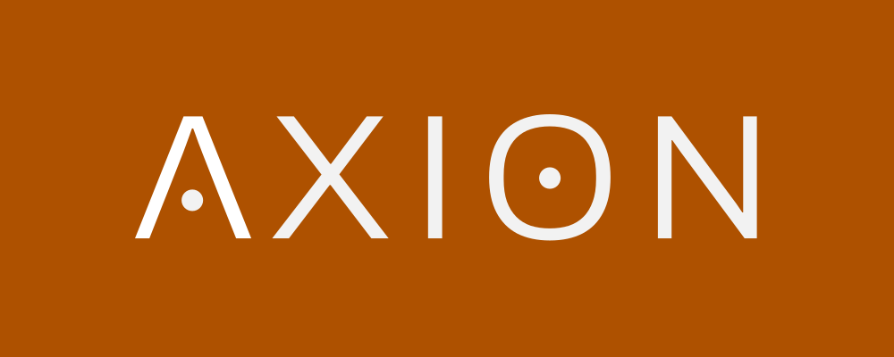

<p align="center">
  
</p>

<p align="center">
  
  
  
  
</p>

Frontend do **Axion** — plataforma aberta de trilhas de estudo para autodidatas.

> Para uma visão geral do projeto, acesse o [hub oficial](https://github.com/genzo-dev/axion_hub).

## Tecnologias

- [Next.js](https://nextjs.org/) (App Router)
- [Tailwind CSS](https://tailwindcss.com/) v4
- [TypeScript](https://www.typescriptlang.org/)

## Como rodar

1. Instale as dependências:

```bash
npm install
```

2. Inicie o servidor de desenvolvimento:

```bash
npm run dev
```

3. Acesse [http://localhost:3000](http://localhost:3000).

<!-- ## Landing Page

A copy completa da landing page está em [`LANDING_PAGE_COPY.md`](./LANDING_PAGE_COPY.md), organizada por seções (Hero, Problema, Como funciona, Funcionalidades, etc.) com textos prontos e especificações da NavBar. -->

## Repositórios relacionados

| Repositório                                                 | Função                 |
| ----------------------------------------------------------- | ---------------------- |
| [axion_hub](https://github.com/genzo-dev/axion_hub)         | Hub central do projeto |
| [axion-backend](https://github.com/genzo-dev/axion-backend) | API backend            |
| [axion-docs](https://github.com/genzo-dev/axion-docs)       | Documentação geral     |

## Autor

<div align="center">
  
</div>

<div align="center">
  <strong>Gabriel Enzo (genzo-dev)</strong>
</div>

<div align="center">
  <sub>Fullstack web developer</sub>
</div>

&nbsp;

<div align="center">
  <a href="https://www.linkedin.com/in/gabriel-enzo-200403233/">💼 LinkedIn</a>
  |
  <a href="https://github.com/genzo-dev">🐙 GitHub</a>
</div>
